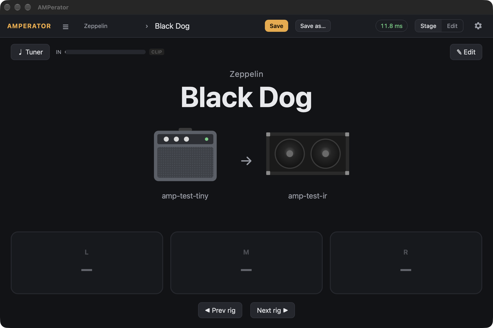
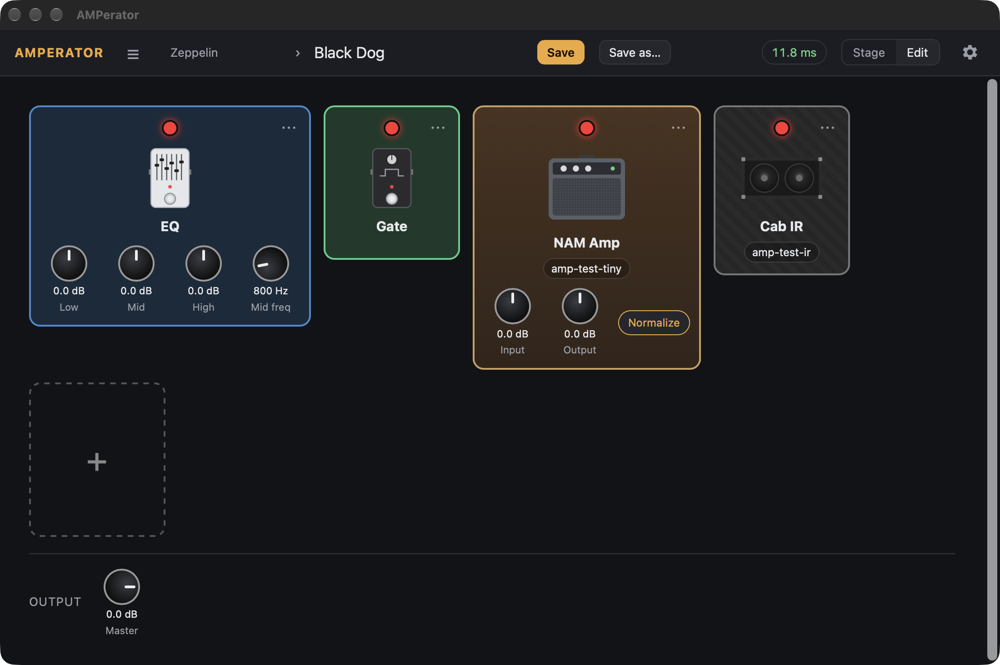
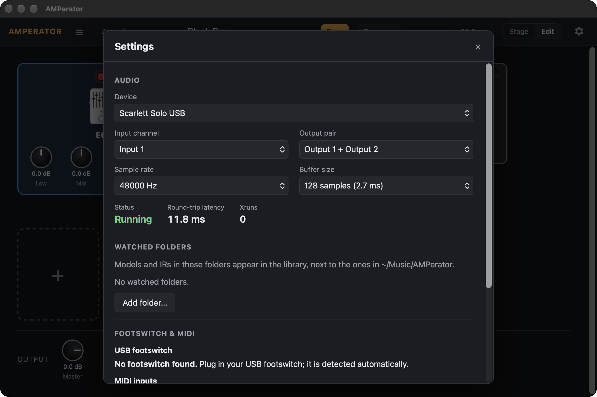

# AMPerator

**A standalone guitar rig player: NAM amp models, cab IRs, your VST3/AU plugins, and a USB footswitch — without opening a DAW.**

AMPerator fills the gap between [Neural Amp Modeler](https://www.neuralampmodeler.com/) (great tones, but just an amp loader) and a full DAW (does everything, but too heavy to open when you just want to jam). You open it, it loads the rig you played last, and you play.

- **Amps and cabs:** load any `.nam` capture and any `.wav` cabinet impulse response.
- **FX chains:** gate, EQ, and any VST3 or Audio Unit plugin you already own, in any order, with a master level.
- **Rigs by band:** save a chain as *Led Zeppelin › Black Dog* or *STP › Interstate Love Song* and flip between them.
- **Footswitch:** a cheap 3-pedal USB footswitch (or any MIDI controller) toggles pedals, Ableton-style "learn".
- **Stage mode:** a big, readable jam screen with footswitch tiles, an input meter and a tuner.
- **Low latency:** ~10 ms round trip on a Focusrite Scarlett at a 128-sample buffer; lower at 64.

Open source under the AGPLv3. macOS today; the code is cross-platform (JUCE 8) and a Windows build is planned.

## Screenshots

**Stage mode** — what the app opens into. Band and rig name, amp → cab, three footswitch tiles, prev/next rig, meter, tuner.



**Edit mode** — the pedalboard. Click a card for its knobs, drag to reorder, `+` to add a built-in or a plugin.



**Settings** — audio device, channels, buffer size with the live latency readout, watched folders, footswitch and MIDI.



## Status

Sub-project 1 (the core rig engine) is complete: 261 C++ tests and 139 UI tests pass, including an offline audio regression suite. Real-hardware checks are tracked in [docs/manual-test-checklist.md](docs/manual-test-checklist.md). Planned next:

1. **Tone library search** — find and download amp models and IRs from public libraries (TONE3000) inside the app.
2. **AI tone builder** — "I want to play Interstate Love Song by STP" → the app finds the closest models, builds the chain, and you save it.
3. **Advanced foot control** — tap/long-press, scenes (clean / crunch / lead per song), expression pedals.
4. **Windows build** (ASIO).

## Build

Requirements: macOS with Xcode (Apple clang, C++20), CMake 3.24+, Node 20+ (for the web UI). Every C++ dependency is fetched and pinned by CMake; the first JUCE fetch takes a few minutes.

```sh
cmake -B build -G Xcode
cmake --build build --target AMPerator      # the app → build/app/AMPerator_artefacts/Debug/AMPerator.app
open build/app/AMPerator_artefacts/Debug/AMPerator.app
```

Tests:

```sh
cmake --build build --target amp_tests && ctest --test-dir build -C Debug   # C++ engine (Catch2)
(cd ui && npm install && npx vitest run)                                     # web UI (vitest)
```

Set `-DAMP_BUILD_APP=OFF` to build only the engine and tests (no Node needed). In a Debug build, `AMP_UI_DEV=1` loads the UI from a Vite dev server at `localhost:5173` (`cd ui && npm run dev`) for hot reload.

## Using it

### Your library

Everything lives in `~/Music/AMPerator/` (Windows: `Documents\AMPerator\`):

| Folder | What goes there |
|---|---|
| `Models/` | NAM amp captures (`.nam`) |
| `IRs/` | cabinet impulse responses (`.wav`, `.aiff`) |
| `Rigs/<Band>/` | saved rigs (`.amprig`, plain JSON) plus their last 5 backups |
| `Art/` | images you assign to pedals, amps or cabs |
| `settings.json` | audio device, footswitch keys, global mappings, recents |

Drop files into `Models/` and `IRs/`, or point Settings → *Watched folders* at the folder where you already keep your NAM downloads; nothing is copied. Rigs reference their files by content hash, so you can rename or move files freely. A rig that references a model or plugin you don't have still loads — the missing node is shown as a bypassed placeholder with its settings intact, and you can **Locate…** the file.

### First launch

1. macOS asks for **microphone** access (that's your audio interface input). Allow it.
2. Open Settings (gear icon), pick your interface, input channel, output pair and buffer size. The round-trip latency is shown live.
3. Switch to **Edit**, click the NAM Amp card to pick a model and the Cab IR card to pick an IR, then **Save** under a band name.

### Rigs

- **Save** keeps the last 5 versions as `.bak` files beside the rig; **Save as…** makes a copy under a new name.
- A rig file that gets corrupted shows an error with an **Open last backup** action instead of silently disappearing.
- Quitting or switching rigs with unsaved changes asks first.

**Tags.** Give a rig as many free-form tags as you like — a style or decade (`clean`, `70s`), and the bands and songs you use it for (`Parkway Drive`, `Wild Eyes`) — so a rig called *Peavey 5150 - Djent* is still easy to find without renaming it. Add them in Edit, in the *Tags* row above the pedalboard (Enter or comma adds one, ✕ removes one, known tags are suggested as you type); they are saved with the rig and shown under its name on the Stage. In the library, the search field matches rig names, bands and tags, and the tag bar below it filters by one or more tags (all must match). `⌘F`, or `/`, jumps to the search.

### Plugins

`+` → *Plugins…* lists your VST3 and AU plugins after a scan (the *Rescan* button in that picker; it blocks the app for a moment). A plugin that crashes during a scan or load is disabled on the next launch, with a **Retry** in Settings → *Disabled plugins*. Each plugin node has an **Open editor** action for its own window.

### Footswitch and MIDI

AMPerator reads a USB footswitch directly over HID so pedal presses control the rig even when another app is in front. Supported out of the box: the common 3-pedal boards (PCsensor / iKKEGOL style) that act as a keyboard; any other HID keyboard-type device can be chosen manually in Settings → *Footswitch & MIDI* → *Use as footswitch*.

- macOS asks for **Input Monitoring** permission the first time. Grant it in System Settings → Privacy & Security → Input Monitoring, then relaunch.
- The app tries to take the pedal **exclusively** (presses don't reach other apps). If macOS won't allow that, Settings shows *shared* mode; reprogram the pedal to send **F13 / F14 / F15** with its vendor tool so it types nothing visible.
- If your pedal sends keys other than the defaults, use **Assign L / M / R**: click, stomp, done. The dialog shows the last key code it saw.
- Mapping a pedal to an effect: in Edit, right-click a card → **Learn footswitch**, then stomp. Mappings are saved in the rig; global defaults live in settings.
- Any MIDI controller works the same way (notes and CCs).

### Keyboard shortcuts (Stage)

`←` / `→` previous / next rig · `T` tuner · `E` edit.

## How it's built

```
engine/   headless C++ library (JUCE 8): rig model + graph edits, content-hash asset index,
          DSP nodes (gate, EQ, NAM amp with host-rate resampling, cab IR convolution),
          real-time processing plan with crossfaded swaps and click-free bypass,
          VST3/AU hosting with crash blacklist, rig store with atomic saves + backups,
          audio device wrapper with auto-reconnect, HID footswitch + MIDI, mapping/learn,
          YIN tuner, and a versioned JSON bridge for the UI
app/      the macOS app: a JUCE window hosting a WKWebView, plugin editor windows
ui/       the interface: Vite + TypeScript, no framework (Stage, Edit, library, settings)
tests/    Catch2 suites for every engine unit + offline audio regression renders
docs/     bridge protocol, manual hardware checklist, design specs and plans
```

Design principles: the audio thread never allocates, locks or touches a file (a debug-build guard proves it); everything that can fail — a missing model, a crashing plugin, a corrupt rig file, an unplugged interface — degrades to something you can still play through. The UI talks to the engine only through the JSON protocol in [docs/bridge-protocol.md](docs/bridge-protocol.md), so the engine runs headless under test.

### Audio regression references

`tests/fixtures/reference/*.wav` are offline renders of reference rigs. After an intentional DSP change, regenerate them with

```sh
AMP_UPDATE_REFERENCES=1 ctest --test-dir build -C Debug -R audio_regression
```

That run deliberately reports a failure after writing the files, so it can never pass by comparing against itself. Listen to the new WAVs, commit them, and rerun without the variable.

## License

AMPerator is licensed under the [GNU AGPLv3](LICENSE). It builds on JUCE (AGPLv3), NeuralAmpModelerCore (MIT), hidapi (BSD) and Eigen (MPL-2.0); see [THIRD_PARTY.md](THIRD_PARTY.md). The amp, cab and pedal artwork is generic and original — no manufacturer names or logos are used, and model names shown in the app are the names of the files you load.
